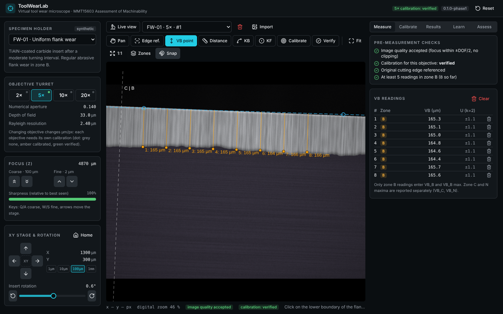
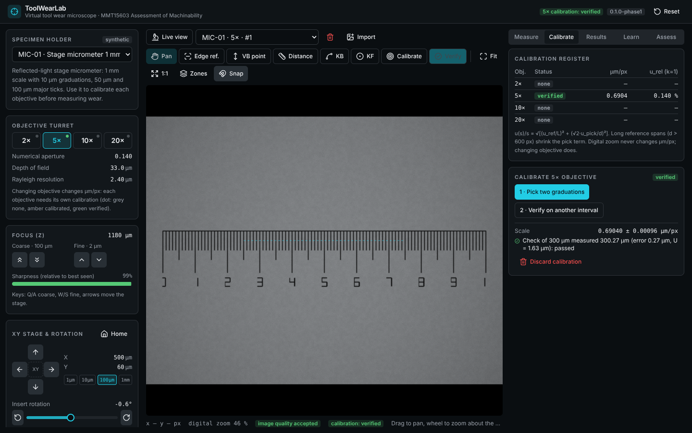
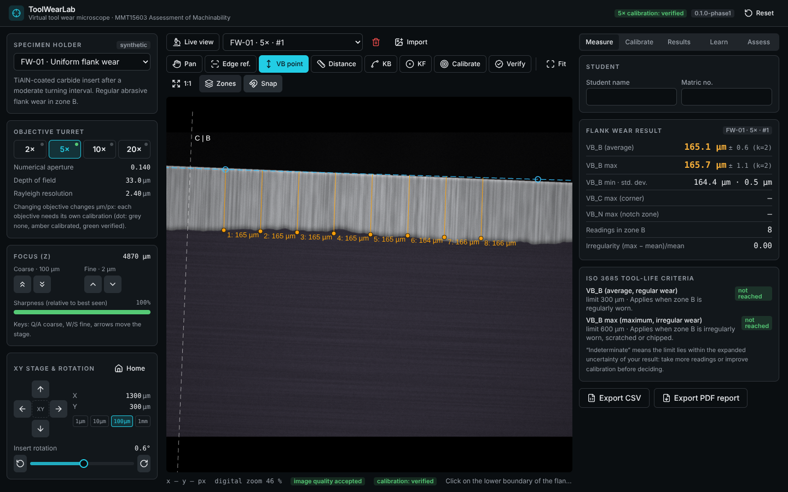

# ToolWearLab

**▶ Open the app: [nabilkhalil.github.io/toolwearlab](https://nabilkhalil.github.io/toolwearlab/)**

Virtual tool wear microscope for **MMT15603 Assessment of Machinability**. Students position a cutting insert, focus, set illumination, calibrate against a stage micrometer and measure flank wear following ISO 3685 principles, entirely in the browser.

- **No server, no login, no API keys.** Practice data stays in the browser (localStorage) and can be exported as CSV or PDF.
- **Traceable numbers.** Every reading carries a calibration status and an uncertainty; captures are refused if focus or exposure is unsuitable.
- **Honest data.** Built-in specimens are synthetic, rendered from documented parameters; real micrographs can be imported and calibrated.



## How to use

Use a desktop or laptop browser. Your work is saved in that browser; **Reset** (top right) clears it. New users should start with the **Learn** tab: its four guided lessons follow the steps below and tick each one off as you complete it.

### 1. Set up the microscope (left panel)

1. **Specimen holder**: load **MIC-01** (stage micrometer, 1 mm in 0.01 mm divisions).
2. **Objective turret**: choose **5×**.
3. **Focus**: coarse focus until the graduations appear, then fine focus until the status reads **In focus** and sharpness is near 100 %.
4. **Light / exposure**: adjust until the histogram does not clip (red = saturated, blue = black).
5. **Rotation**: rotate until the graduations are vertical. This makes picking easier; it does not affect accuracy.
6. **Capture** (or press `C`). A capture is refused if focus or exposure is out of limits.

### 2. Calibrate (Calibrate tab)



1. With the **Calibrate** tool, click two graduation lines as far apart as possible. **Snap** centres each pick on the line.
2. Enter the number of 0.01 mm divisions between them (e.g. 250 µm → 750 µm = 50).
3. With **Verify**, measure a different pair of lines. The calibration passes when the error is within its uncertainty, and the header shows **calibration: verified**.

Each objective needs its own calibration. Digital zoom (mouse wheel) never changes µm/px; changing objective always does.

### 3. Measure flank wear

1. Back in **Live view**, load **FW-01**, keep 5×, refocus (the insert sits at a different height) and capture.
2. Turn on **Zones** to show zones C, B and N. VB_B is evaluated in **zone B** only.
3. **Edge ref.**: click two points far apart on the **original cutting edge** (the top boundary of the flank face). VB is measured perpendicular to this line, so a tilted insert does not bias the result.
4. **VB point**: click the **lower boundary of the bright wear land** at 8 or more positions spread along zone B, including the widest point. Zoom in for precise picks. Drag a point to adjust it; `Esc` cancels a half-finished pick.

### 4. Results tab



- Enter your name and matric number.
- Read **VB_B (average)** and **VB_B max**, each with its expanded uncertainty U (k = 2).
- The **ISO 3685 decision** compares VB_B with 0.3 mm (regular wear) or VB_B max with 0.6 mm (irregular wear). *Indeterminate* means the limit lies within ±U: take more readings or improve the calibration.
- **Export CSV** or **Export PDF report** to submit your work.

The **Assess** tab has graded practice activities. **Import** loads your own micrographs, which must be calibrated before measuring.

### Keyboard shortcuts (Live view)

| Key | Action |
|---|---|
| `Q` / `A` | Coarse focus up / down (100 µm) |
| `W` / `S` | Fine focus up / down (2 µm) |
| Arrow keys | Move stage 50 µm (`Shift` + arrow: 500 µm) |
| `C` | Capture |
| `Esc` | Cancel a pending pick (frame view) |

### Specimens

| ID | View | Content | Practise |
|---|---|---|---|
| MIC-01 | Stage micrometer | 1 mm, 0.01 mm divisions | Calibration |
| FW-00 | Flank | Unworn reference | Recognising the original edge |
| FW-01 | Flank | Uniform flank wear | Standard VB_B measurement |
| FW-02 | Flank | Irregular flank wear with a local peak | VB_B max and the 0.6 mm criterion |
| NW-01 | Flank | Notch wear at depth-of-cut line | Locate at x ≈ 1.6 mm; reported as VB_N, not in VB_B |
| CR-01 | Rake | Crater wear | Compare coaxial vs ring light; KB, KF measurable, KT not |

## Development

```bash
npm ci
npm run dev          # http://localhost:5173
npm test             # unit tests (Vitest)
npm run test:e2e     # acceptance tests (Playwright; set CHROMIUM_PATH if the browser download is blocked)
npm run build        # static site in dist/ (GitHub Pages ready)
npm run build:single # single self-contained HTML in dist-single/
```

### Deploy to GitHub Pages

Push to `main`. The workflow in `.github/workflows/deploy.yml` type-checks, runs unit and e2e tests, builds and publishes `dist/`. Enable *Settings → Pages → Source: GitHub Actions* once.

## Documentation

- `docs/ARCHITECTURE.md`: architecture, data models, component specifications, UI plan, uncertainty model, acceptance results and roadmap.
- `.claude/skills/*/SKILL.md`: project rules for Claude (ISO 3685 domain, optical metrology model, validation obligations, UI conventions).
